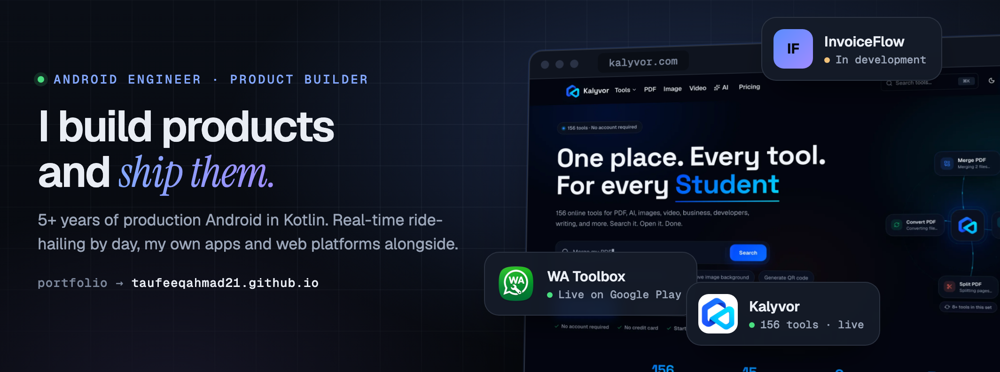
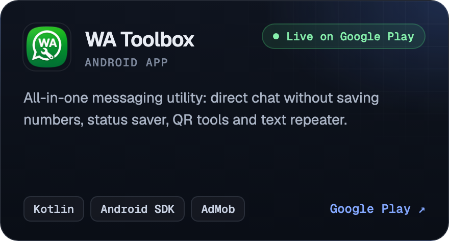
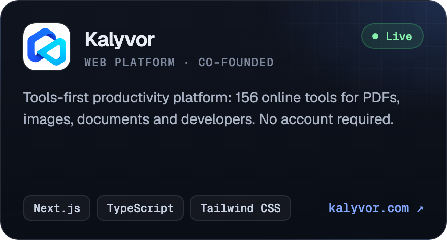
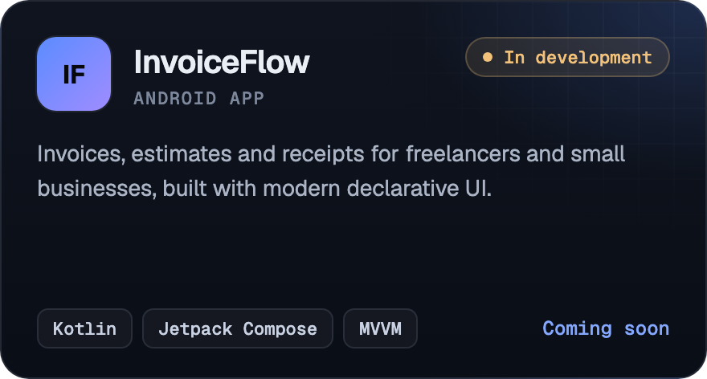
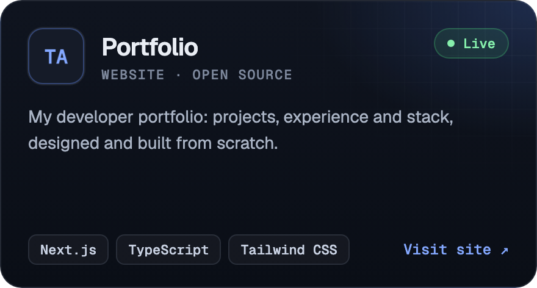

<a href="https://taufeeqahmad21.github.io">
  
</a>

<br><br>

<p align="center">
  <a href="https://www.linkedin.com/in/taufeeqahmaddev"></a>&nbsp;
  <a href="https://taufeeqahmad21.github.io"></a>&nbsp;
  <a href="mailto:taufeeqahmad2998@gmail.com"></a>&nbsp;
  <a href="https://www.fiverr.com/s/EgBxj57"></a>
</p>

<br>

### Hi, I'm Taufeeq

Android engineer with **5+ years** shipping production apps in Kotlin and Java. Most of my work is real-time: live driver tracking, in-trip updates and driver–passenger messaging for ride-hailing platforms. I also design and ship my own products, on Android and on the web.

```kotlin
object Taufeeq {
    val role     = "Android Engineer · Product Builder"
    val location = "Lahore, Pakistan · working remote"
    val focus    = listOf("Real-time apps", "Performance & stability", "Clean Architecture")
    val now      = listOf("Android @ My Taxi Ride", "Growing Kalyvor", "Building InvoiceFlow")
    val askMe    = "MQTT, live location, ANRs, Jetpack Compose"
}
```

<br>

### Selected work

<table>
  <tr>
    <td width="50%"><a href="https://play.google.com/store/apps/details?id=com.watoolbox.app"></a></td>
    <td width="50%"><a href="https://kalyvor.com"></a></td>
  </tr>
  <tr>
    <td width="50%"></td>
    <td width="50%"><a href="https://taufeeqahmad21.github.io"></a></td>
  </tr>
</table>

<br>

### Experience

**Android Developer · My Taxi Ride Inc** &nbsp;`2021 – present` &nbsp;`remote`
- Built live driver tracking and trip-status updates with Google Maps SDK, Firebase and MQTT
- Reduced crash and ANR rates by restructuring background processing and main-thread work
- Integrated REST APIs and push messaging for booking, dispatch and in-trip communication

**Mobile Application Developer · BrindaSoft** &nbsp;`2018 – 2022`
- Developed Android features for a scalable taxi platform: real-time location, driver–passenger communication and live trip updates

**Also built:** a push-to-talk voice app over MQTT and SignalR with long-running background services, and identity verification with AWS Face Liveness.

<br>

### Toolbox

<p>
  
</p>

**Android:** Jetpack Compose · Coroutines & Flow · MVVM · Clean Architecture · Retrofit · Room · CameraX · Google Maps SDK<br>
**Real-time & cloud:** MQTT · SignalR · Firebase · AWS Amplify · REST APIs

<br>

### How I work

**Performance first.** Main thread stays free, so the app stays responsive on budget phones, not only flagships.<br>
**Built to change.** Clear layers and boundaries so features stay testable as the codebase grows.<br>
**Ship, then listen.** The smallest useful version goes out, and real users decide what comes next.

<br>

<p align="center">
  <sub>Open to Android and software engineering roles, remote or on-site · <a href="mailto:taufeeqahmad2998@gmail.com">taufeeqahmad2998@gmail.com</a></sub>
</p>
